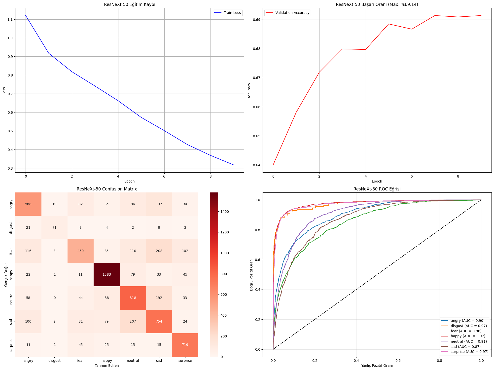
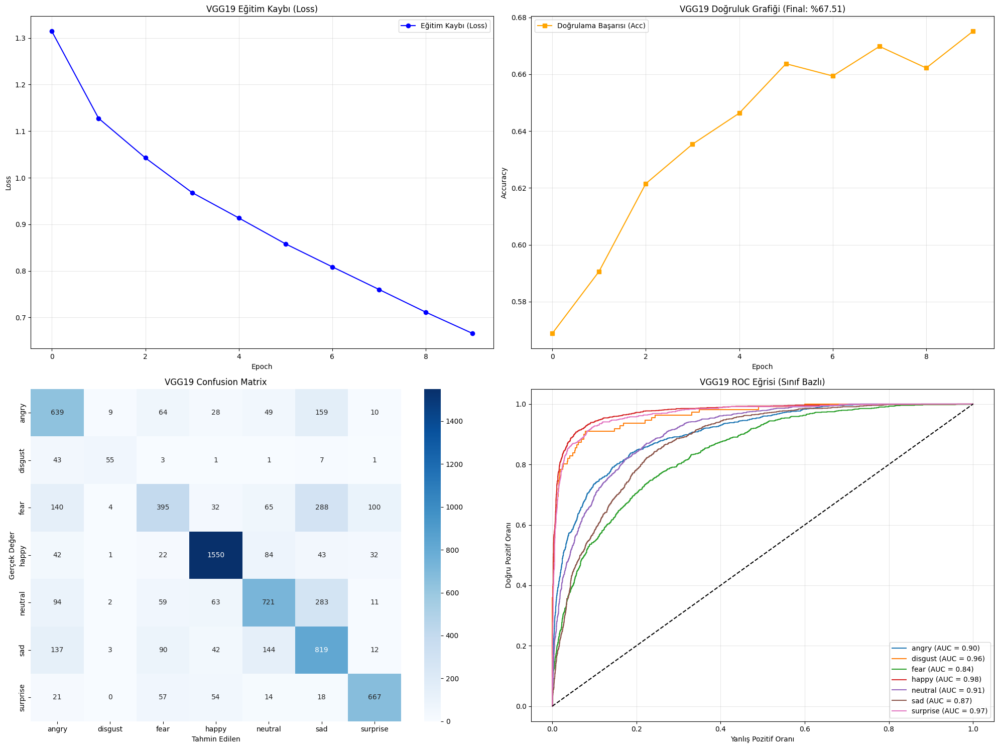
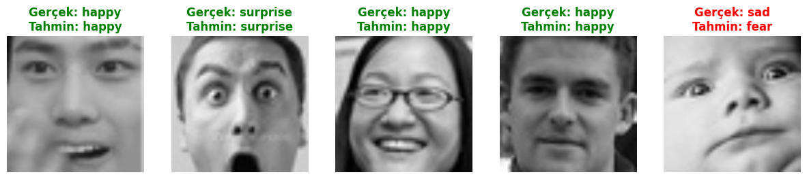

# 🎭 DevEmotion — Duygu Tanıma Modelleri (Bireysel Katkı)

> ⚠️ **Bu, 5 kişilik bir ekip projesi olan DevEmotion'ın bir parçasıdır.** Bu repo yalnızca benim (Mert Ali Kızılkaya) bireysel katkım olan **ResNeXt-50** ve **VGG19** model deneylerini içerir. Ekibin tüm projesi için: **[github.com/Efeyamann/Devemotion](https://github.com/Efeyamann/Devemotion)**
>
> **Ekip:** Efe Yaman Sir, Mert Ali Kızılkaya, Fırat Soykan, Ahmet Baran Vardar, Yiğit Ali Çolakoğlu — her üye farklı bir derin öğrenme mimarisini (CNN, ResNet, DenseNet, ResNeXt, VGG19 vb.) bağımsız olarak test edip karşılaştırmıştır.

Derin öğrenme ile yüz ifadelerinden duygu sınıflandırması yapan ve tahmin edilen duyguya göre film önerisi sunan bir sistem. İki farklı transfer learning yaklaşımı (ResNeXt-50 ve VGG19) karşılaştırmalı olarak uygulanmıştır.

## Sonuçlar

| Model | Yaklaşım | Doğrulama Başarısı |
| --- | --- | --- |
| **ResNeXt-50** 🏆 | Tek aşamalı fine-tuning | **%69.14** |
| VGG19 | İki aşamalı (özellik çıkarımı → fine-tuning) | %67.51 |

7 sınıf: `angry`, `disgust`, `fear`, `happy`, `neutral`, `sad`, `surprise`

| ResNeXt-50 — Sonuçlar | VGG19 — Sonuçlar |
| --- | --- |
|  |  |



## Veri seti

- **[FER-2013](https://www.kaggle.com/datasets/msambare/fer2013)** (Facial Expression Recognition 2013): 35.887 gri tonlamalı 48×48 yüz görseli, 7 duygu sınıfı. Boyutu nedeniyle (~63 MB) bu depoya dahil edilmemiştir; yukarıdaki Kaggle linkinden indirip proje köküne `archive.zip` olarak yerleştirin (not defterleri otomatik olarak çıkarır).
- **[IMDB Top 1000](https://www.kaggle.com/datasets/harshitshankhdhar/imdb-dataset-of-top-1000-movies-and-tv-shows)**: film önerisi özelliği için kullanılır, `imdb_top_1000.csv` olarak depoda hazır gelir.

## Yöntem

İki model de ImageNet üzerinde önceden eğitilmiş ağırlıklarla başlar (transfer learning):

- **ResNeXt-50:** Son tam bağlantılı katman 7 sınıfa göre yeniden tanımlanır, tüm ağ tek aşamada 10 epoch eğitilir.
- **VGG19:** İki aşamalı strateji — önce evrişim katmanları dondurulup yalnızca yeni sınıflandırıcı eğitilir (özellik çıkarımı), ardından tüm katmanların kilidi açılıp daha düşük bir öğrenme hızıyla fine-tuning yapılır.

Her iki not defterinde de: eğitim/doğrulama eğrileri, karmaşıklık matrisi, sınıf başına ROC eğrisi (AUC ile), örnek tahmin görselleştirmesi ve **duyguya göre film önerisi** bulunur.

## Teknolojiler

PyTorch, torchvision (ResNeXt-50, VGG19-BN — ImageNet önceden eğitilmiş ağırlıklar), scikit-learn (metrikler), matplotlib, seaborn, pandas

## Kurulum ve çalıştırma

```bash
git clone https://github.com/mertokzlky/devemotion-model-deneyleri.git
cd devemotion-model-deneyleri
pip install -r requirements.txt
```

1. [FER-2013](https://www.kaggle.com/datasets/msambare/fer2013) veri setini indirip `archive.zip` olarak proje köküne koyun.
2. `notebooks/resnext50_duygu_tanima.ipynb` ya da `notebooks/vgg19_duygu_tanima.ipynb` dosyasını Jupyter'da açıp üstten alta çalıştırın.

> **Not:** Eğitim GPU gerektirir (orijinal çalışma Google Colab'da yapılmıştır); CPU üzerinde 10 epoch'luk eğitim saatler sürebilir. GPU'ya erişiminiz yoksa [Google Colab](https://colab.research.google.com) veya [Kaggle Notebooks](https://www.kaggle.com/code) ücretsiz GPU sunar.

## Proje yapısı

```
devemotion-model-deneyleri/
├── notebooks/
│   ├── resnext50_duygu_tanima.ipynb   # ResNeXt-50 deneyi (tüm sonuçlarıyla)
│   └── vgg19_duygu_tanima.ipynb       # VGG19 deneyi — iki aşamalı fine-tuning
├── imdb_top_1000.csv                  # Film önerisi için kullanılan veri seti
├── requirements.txt
├── .gitignore
└── docs/screenshots/
```

> `archive.zip` (FER-2013) ve eğitilmiş `.pth` model dosyaları boyut nedeniyle depoda yer almaz (`.gitignore`'a bakın).

## Geliştirme fikirleri

- Çapraz doğrulama (cross-validation) ile sonuçların sağlamlaştırılması
- Daha fazla epoch / öğrenme hızı programlayıcı (learning rate scheduler) ile karşılaştırma
- Ekibin denediği diğer mimaraların (CNN, ResNet, DenseNet) da bu repoya eklenmesi
- Modelin bir Streamlit/Gradio arayüzüyle canlıya alınması (webcam üzerinden gerçek zamanlı tahmin)

## Sorumluluk reddi

Bu proje bir üniversite dersi kapsamında geliştirilmiş akademik bir çalışmadır. Film önerisi özelliği gösterim amaçlıdır.

## Geliştirici

**Mert Ali Kızılkaya** — Yazılım Mühendisliği öğrencisi
GitHub: [@mertokzlky](https://github.com/mertokzlky)

DevEmotion ekip projesi kapsamında geliştirilmiştir. Ekibin tam projesi: [github.com/Efeyamann/Devemotion](https://github.com/Efeyamann/Devemotion)
